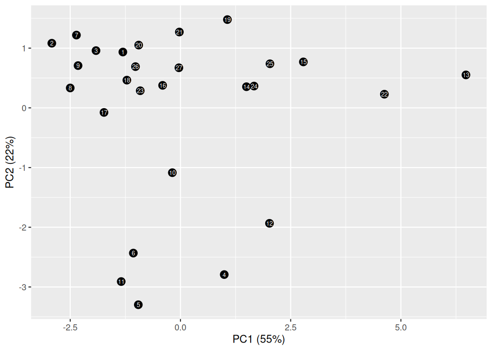

# Cytokine Response PCA

Explore cytokine responses across nine drugs using control-normalized fold changes, correlations, principal component analysis and Varimax rotation.

## Quick start

Requires R. The setup script installs Hmisc, corrplot, reshape, ggplot2, scales and psych. Tested with R 4.5.2.

Run from the repository root:

```sh
Rscript install_packages.R
Rscript run.R
```

## Input

[`data/cytokine_responses.csv`](data/cytokine_responses.csv) contains 27 observations, a `cytokines` column, a `Control` column and nine drug-response columns. It uses semicolon separators and decimal commas.

The analysis divides each drug response by its corresponding control and applies log2 transformation. When replacing the data, retain the column layout or update the column selections in [`analysis.R`](analysis.R); values used in log ratios must be positive.

## Output

- `results/pca_scores.csv`: observation scores for each principal component.
- `results/explained_variance.csv`: the proportion of variance explained by each component.
- `results/pca.png`: the first two components, labeled by input row number.
- `results/plots.pdf`: response distributions, correlation plots and component plots.

The first two components explain **55.07%** and **21.82%** of variance in the included data.



The final section of the script runs a separate simulated MANOVA example. It does not use the cytokine dataset. These analyses are exploratory and do not establish drug efficacy.

## Acknowledgments

University of Skövde for the example dataset and learning resources.
